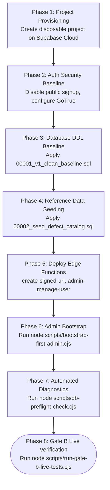

# SAMPLE TRACKING V1.0 — CLEAN BASELINE MIGRATION & DEPLOYMENT PLAN
**Project:** `C:\Sample report - AI`  
**Role:** Senior Supabase/PostgreSQL Architect and Security Engineer  
**Scope:** Migration consolidation strategy, historical migration archiving, fresh Supabase project installation procedure, and required application changes.  
**Date:** October 11, 2026  

---

## 1. STRATEGIC RATIONALE: CONSOLIDATED BASELINE VS. INCREMENTAL PATCHES

### 1.1 The Problems of Running 12 Incremental Migrations
In a fresh database installation, running migrations `00001` through `00012` sequentially causes multiple technical defects:
1. **Migration-Order Deadlock on Closed Jobs (R8-01/R8-02):**
   - Migration `00007` attaches immutable locks on closed jobs.
   - Migration `00010` runs `UPDATE qa_checks` and `UPDATE job_operations` to backfill `event_seq`.
   - If any seed or initial data contains closed jobs, `00010` throws an exception and halts deployment before reaching `00011` or `00012`.
2. **Dead Enum Values and Column Churn:**
   - Migration `00001` creates `WAITING_QA`, `QA_KIV`, `QA_NG` in `operation_status`. Migration `00007` deprecates them, but PostgreSQL cannot remove enum values from an existing enum type without recreating it.
   - Multiple columns (`upload_status`, `content_hash`, `reopened_at`, `owning_department`) are added, altered, and patched across migrations `00006` through `00012`.
3. **Suffix Proliferation and Redundant Function Wrappers:**
   - Functions are created, dropped, and replaced up to four times (`_r5`, `_r7`, `_r8`, `_r9`).
   - Redundant compatibility wrappers clutter the catalog.

### 1.2 The Clean Baseline Solution
Because **there is no live production database or existing user data that must be preserved**, the optimal engineering solution is to consolidate the entire post-R9 architecture into a single, clean, declarative baseline:
- `supabase/migrations/00001_v1_clean_baseline.sql`
- `supabase/seeds/00002_seed_defect_catalog.sql`

This guarantees:
- Fast, atomic, 100% reproducible installation.
- Clean object names without version suffixes (`confirm_attachment_upload` instead of `_r9`).
- Elimination of dead enum values and temporary repair scripts.

---

## 2. HISTORICAL MIGRATION ARCHIVING STRATEGY

### 2.1 Archiving Requirement
Supabase CLI and automated deployment pipelines execute every `.sql` file found in `supabase/migrations/` in alphanumeric order. If the historical migrations `00001_initial_schema.sql` through `00012_security_stabilization_r9.sql` remain in `supabase/migrations/`, any new migration runner would execute them sequentially and encounter the known historical conflicts.

### 2.2 Archiving Procedure
Historical migrations must be preserved for audit compliance, legal evidence, and git traceability, but isolated from active deployment:

```
C:\Sample report - AI\
└── supabase/
    ├── migrations/                              <-- ACTIVE MIGRATIONS ONLY
    │   └── 00001_v1_clean_baseline.sql          <-- Unified baseline (Phase B2)
    │
    ├── migrations_archive_r1_r9/               <-- HISTORICAL AUDIT ARCHIVE
    │   ├── 00001_initial_schema.sql
    │   ├── 00002_rls_policies.sql
    │   ├── 00003_reference_catalogs.sql
    │   ├── 00004_security_remediation_r1.sql
    │   ├── 00005_security_remediation_r2.sql
    │   ├── 00006_security_remediation_r3.sql
    │   ├── 00007_security_business_workflow_r4.sql
    │   ├── 00008_security_remediation_r5.sql
    │   ├── 00009_storage_disposition_security_r6.sql
    │   ├── 00010_security_remediation_r7.sql
    │   ├── 00011_security_remediation_r8.sql
    │   └── 00012_security_stabilization_r9.sql
    │
    ├── functions/
    │   ├── admin-manage-user/
    │   └── create-signed-url/
    └── seeds/
        ├── demo_jobs.sql                        <-- Dev only (never prod)
        └── 00002_seed_defect_catalog.sql       <-- Standard reference catalog
```

### 2.3 Preserving Git Integrity
- Files will be moved via `git mv` (or file system move preserved in git commits).
- All commit messages, audit reports, and finding matrices in `docs/` and reports remain 100% intact.
- A `README.md` will be placed in `supabase/migrations_archive_r1_r9/` documenting the historical audit trajectory (R1 through R9).

---

## 3. FRESH SUPABASE PROJECT INSTALLATION PROCEDURE



### Detailed Execution Steps:

#### Step 1: Supabase Cloud Project Provisioning
1. Log in to [Supabase Dashboard](https://supabase.com).
2. Create a new disposable project: `sample-tracking-baseline-v1`.
3. Note project credentials:
   - `Project URL`
   - `anon public key`
   - `service_role secret key`

#### Step 2: Authentication Security Baseline
1. Navigate to **Authentication > Providers > Email**.
2. **Disable** `Enable Email Signup` (prevents unapproved public registrations).
3. Confirm that account generation is restricted to Admin CLI provisioning (`scripts/provision-user.cjs`).

#### Step 3: Database Baseline DDL Execution
1. In Supabase CLI or SQL Editor:
   ```bash
   supabase db reset
   # or execute supabase/migrations/00001_v1_clean_baseline.sql
   ```
2. Creates:
   - 2 extensions (`uuid-ossp`, `pgcrypto`).
   - 6 custom enums.
   - 11 application tables.
   - Primary keys, foreign keys, unique and check constraints.
   - Indexes for performance and foreign key lookups.
   - Private storage bucket `sample-documents`.
   - Row Level Security policies on all 11 tables and Storage objects.
   - Triggers for timestamps, audit logs, workflow progression, and closed-job locks.
   - Canonical RPC functions (`confirm_attachment_upload`, `fail_attachment_upload`, `retry_attachment_upload`, `get_current_user_role`, `is_user_active`, `is_authorized_pe_decision_maker`).

#### Step 4: Reference Catalog Seeding
1. Execute `supabase/seeds/00002_seed_defect_catalog.sql`.
2. Inserts the 10 standard manufacturing defect categories (DF-01 through DF-10).
3. **DO NOT** execute `demo_jobs.sql` on a production or Gate B test database.

#### Step 5: Edge Function Deployment
Deploy the two required Edge Functions with 300s TTL enforcement:
```bash
supabase functions deploy create-signed-url --no-verify-jwt
supabase functions deploy admin-manage-user --no-verify-jwt
```

#### Step 6: Initial Administrator Provisioning
Run the secure bootstrap script to provision the first Admin account:
```bash
node scripts/bootstrap-first-admin.cjs
```

#### Step 7: Automated Preflight Diagnostic Verification
Run the dynamic preflight verification tool:
```bash
node scripts/db-preflight-check.cjs
```
Confirms 100% PASS on schema readiness, storage bucket permissions, and constraint integrity.

---

## 4. APPLICATION & EDGE FUNCTION CHANGES

To align with the clean V1.0 baseline (eliminating version-suffixed RPC calls):

### 4.1 React Service Layer (`src/services/attachmentUploadService.ts`)
- **Current State:** Contains fallback logic attempting `confirm_attachment_upload_r9`, then `_r8`, then `_r7`.
- **Target State:** Directly calls clean, canonical RPC functions:
  ```typescript
  // Simplified confirm call
  const { data, error } = await supabase.rpc('confirm_attachment_upload', {
    p_attachment_id: attachmentId,
  });

  // Simplified fail call
  const { data, error } = await supabase.rpc('fail_attachment_upload', {
    p_attachment_id: attachmentId,
    p_error: errorMessage || 'Client upload failed',
  });

  // Simplified retry call
  const { data, error } = await supabase.rpc('retry_attachment_upload', {
    p_attachment_id: attachmentId,
    p_new_size: newSize || null,
    p_new_mime: newMime || null,
    p_new_hash: newHash || null,
  });
  ```

### 4.2 Edge Function `create-signed-url`
- Remove legacy checks for historical columns.
- Retain strict 300-second maximum expiration cap.
- Retain Option A check (`status != 'PURGED'` and registered READY document).

### 4.3 Scripts & Test Runners
- Update `scripts/db-preflight-check.cjs` to target the canonical baseline schema.
- Update `scripts/run-gate-b-live-tests.cjs` to invoke canonical RPC names.
- Update `src/test/securityWorkflow.test.ts` to assert canonical baseline invariants.

---

## 5. RISK ASSESSMENT & MITIGATION

| Identified Risk | Severity | Mitigation Strategy |
| :--- | :---: | :--- |
| **Accidental execution of historical migrations** | HIGH | Move historical files out of `supabase/migrations/` into `supabase/migrations_archive_r1_r9/`. |
| **Discrepancy between TypeScript types and SQL** | MEDIUM | Regenerate `src/types/database.types.ts` from clean baseline schema after deployment. |
| **Client-side RPC naming mismatch** | MEDIUM | Provide backwards-compatible SQL alias functions in baseline during transition, then clean up. |
| **Accidental execution of seed data on prod** | HIGH | Isolate `demo_jobs.sql` into local-only test fixtures; separate reference catalog (`defect_catalog`) into production seed. |
