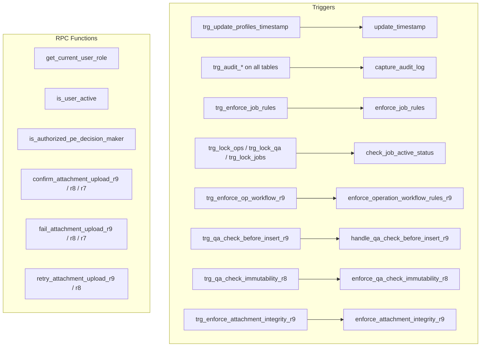

# SAMPLE TRACKING V1.0 — DEFINITIVE SCHEMA INVENTORY & AUDIT (MIGRATIONS 00001–00012)
**Project:** `C:\Sample report - AI`  
**Role:** Senior Supabase/PostgreSQL Architect and Security Engineer  
**Scope:** Complete inventory of database objects, schema evolution across 12 migrations, legacy/redundant object identification, and final intended baseline specification.  
**Date:** October 11, 2026  

---

## 1. EXECUTIVE OVERVIEW

From initial creation through Remediation R9, the Sample Tracking V1.0 schema evolved through 12 incremental migrations (`00001` through `00012`). This incremental patch-and-repair history solved specific security audit findings (R1 through R9), but introduced redundant helper functions, version-suffixed triggers (`_r4`, `_r5`, `_r7`, `_r8`, `_r9`), deprecated session flags, and dead enum values.

Because **there is currently no live production database or existing user data that must be preserved**, we have full authorization to define a clean, unified **V1.0 Baseline Schema**. This document catalogs every database and storage object, details what was modified across the 12 migrations, identifies obsolete objects, and specifies the exact target schema for the clean baseline.

---

## 2. ENUMERATED DATABASE OBJECTS IN CURRENT CODEBASE

### 2.1 Extensions
| Extension | Schema | Purpose | Baseline Status |
| :--- | :--- | :--- | :--- |
| `uuid-ossp` | `extensions` / `public` | UUID generation utilities | **RETAIN** |
| `pgcrypto` | `extensions` / `public` | Cryptographic hashing (`gen_random_uuid`, SHA-256) | **RETAIN** |

---

### 2.2 Custom ENUM Types
| Enum Type | Defined In | Permitted Values | Notes & Observations | Baseline Action |
| :--- | :--- | :--- | :--- | :--- |
| `public.user_role` | `00001` | `'Planning'`, `'PE-MFG'`, `'QA'`, `'Admin'` | Core four manufacturing roles. | **RETAIN** |
| `public.job_status` | `00001` | `'ACTIVE'`, `'CLOSE'`, `'ARCHIVE'`, `'PURGED'` | Job lifecycle states. | **RETAIN** |
| `public.operation_status` | `00001`, `00007` | `'NOT_STARTED'`, `'IN_PROGRESS'`, `'WAITING_QA'`, `'QA_KIV'`, `'QA_NG'`, `'COMPLETED'`, `'HOLD'` | In `00001`, included `WAITING_QA`, `QA_KIV`, `QA_NG`. In `00007` (R4), manufacturing workflow decoupled QA: valid states became `NOT_STARTED`, `IN_PROGRESS`, `COMPLETED`, `HOLD`. The 3 QA statuses are obsolete. | **PRUNE OBSOLETE VALUES** (Keep: `NOT_STARTED`, `IN_PROGRESS`, `COMPLETED`, `HOLD`) |
| `public.qa_result` | `00001` | `'OK'`, `'NG'`, `'KIV'` | Independent QA evaluation outcomes. | **RETAIN** |
| `public.attachment_type` | `00001` | `'DRAWING'`, `'CHECK_SHEET'`, `'SETTING_SHEET'`, `'NG_PHOTO'`, `'OTHER'` | Technical document categories. | **RETAIN** |
| `public.pe_disposition_type` | `00007` | `'CONTINUE_AS_IS'`, `'REWORK_NEXT'`, `'TECHNICAL_REVIEW'`, `'CUSTOMER_EVALUATION'`, `'HOLD'` | Technical resolution types when QA finds NG/KIV. | **RETAIN** |
| `public.attachment_upload_status` | `00010` | `'PENDING'`, `'READY'`, `'FAILED'` | 3-state upload lifecycle. | **RETAIN** |

---

### 2.3 Tables and Column Schema (After Migration 00012)

#### 1. `public.profiles`
| Column | Type | Nullable | Default | Source Migration | Description |
| :--- | :--- | :---: | :--- | :--- | :--- |
| `id` | `UUID` | NO | `auth.users(id)` | `00001` | PK, linked 1:1 with Supabase Auth |
| `phone` | `TEXT` | NO | None | `00001` | Unique canonical phone (+84...) |
| `email` | `TEXT` | YES | None | `00001` | Internal routing email |
| `full_name` | `TEXT` | NO | None | `00001` | Full name of internal employee |
| `role` | `public.user_role` | NO | None | `00001` | Planning, PE-MFG, QA, or Admin |
| `department` | `TEXT` | NO | None | `00001` | Organizational unit |
| `is_active` | `BOOLEAN` | NO | `TRUE` | `00001` | Access control kill-switch |
| `can_make_pe_decisions`| `BOOLEAN` | NO | `FALSE` | `00007` | Flag for PE engineers authorized to make dispositions |
| `created_at` | `TIMESTAMPTZ` | NO | `now()` | `00001` | Record creation timestamp (Asia/Ho_Chi_Minh) |
| `updated_at` | `TIMESTAMPTZ` | NO | `now()` | `00001` | Auto-updated timestamp |

#### 2. `public.jobs`
| Column | Type | Nullable | Default | Source Migration | Description |
| :--- | :--- | :---: | :--- | :--- | :--- |
| `id` | `UUID` | NO | `gen_random_uuid()` | `00001` | Primary Key |
| `job_no` | `TEXT` | NO | None | `00001` | Unique manufacturing order code |
| `part_no` | `TEXT` | NO | None | `00001` | Part identification number |
| `part_name` | `TEXT` | NO | None | `00001` | Part name description |
| `customer` | `TEXT` | NO | None | `00001` | Customer organization |
| `order_qty` | `INTEGER` | NO | None | `00001` | Quantity ordered (> 0) |
| `material` | `TEXT` | NO | None | `00001` | Raw material specification |
| `planned_start_date` | `DATE` | NO | None | `00001` | Scheduled manufacturing start |
| `planned_finish_date` | `DATE` | NO | None | `00001` | Scheduled completion (>= start) |
| `status` | `public.job_status` | NO | `'ACTIVE'` | `00001` | Lifecycle state |
| `pe_owner_id` | `UUID` | YES | `NULL` | `00007` | FK `profiles(id)`: designated PE lead |
| `pe_delegates` | `UUID[]` | YES | `ARRAY[]::UUID[]`| `00007` | Array of authorized PE engineers |
| `closed_at` | `TIMESTAMPTZ` | YES | `NULL` | `00001` | Timestamp when job transitioned to CLOSE |
| `closed_by` | `UUID` | YES | `NULL` | `00001` | FK `profiles(id)` |
| `created_by` | `UUID` | YES | `NULL` | `00001` | FK `profiles(id)` |
| `created_at` | `TIMESTAMPTZ` | NO | `now()` | `00001` | Creation timestamp |
| `updated_at` | `TIMESTAMPTZ` | NO | `now()` | `00001` | Auto-updated timestamp |

#### 3. `public.job_operations`
| Column | Type | Nullable | Default | Source Migration | Description |
| :--- | :--- | :---: | :--- | :--- | :--- |
| `id` | `UUID` | NO | `gen_random_uuid()` | `00001` | Primary Key |
| `job_id` | `UUID` | NO | None | `00001` | FK `jobs(id)` ON DELETE CASCADE |
| `step_order` | `INTEGER` | NO | None | `00001` | Routing step sequence number (>= 1) |
| `operation_name` | `TEXT` | NO | None | `00001` | CNC, Milling, Turning, Polishing... |
| `planned_machine` | `TEXT` | YES | None | `00001` | Machine assignment |
| `planned_cycle_time_seconds` | `NUMERIC(8,2)` | YES | None | `00001` | Standard cycle time |
| `status` | `public.operation_status` | NO | `'NOT_STARTED'` | `00001`, `00007`| Operation status |
| `qa_event_counter` | `BIGINT` | NO | `0` | `00010` | Monotonic counter of QA events |
| `reopened_at` | `TIMESTAMPTZ` | YES | `NULL` | `00008` | Timestamp of explicit PE reopen |
| `reopened_by` | `UUID` | YES | `NULL` | `00008` | FK `profiles(id)` of PE engineer reopening |
| `reopen_reason` | `TEXT` | YES | `NULL` | `00008` | Mandatory justification (>= 5 chars) |
| `created_at` | `TIMESTAMPTZ` | NO | `now()` | `00001` | Creation timestamp |
| `updated_at` | `TIMESTAMPTZ` | NO | `now()` | `00001` | Auto-updated timestamp |

#### 4. `public.production_runs` (Append-Only)
| Column | Type | Nullable | Default | Source Migration | Description |
| :--- | :--- | :---: | :--- | :--- | :--- |
| `id` | `UUID` | NO | `gen_random_uuid()` | `00001` | Primary Key |
| `operation_id` | `UUID` | NO | None | `00001` | FK `job_operations(id)` ON DELETE CASCADE |
| `machine_id` | `TEXT` | NO | None | `00001` | Physical machine identifier |
| `operator_id` | `UUID` | YES | None | `00001` | FK `profiles(id)` |
| `operator_name` | `TEXT` | NO | None | `00001` | Operator display name |
| `start_time` | `TIMESTAMPTZ` | NO | None | `00001` | Batch start time |
| `end_time` | `TIMESTAMPTZ` | NO | None | `00001` | Batch completion time (>= start) |
| `cycle_time_seconds` | `NUMERIC(8,2)` | YES | None | `00001` | Actual cycle time |
| `ok_qty` | `INTEGER` | NO | `0` | `00001` | Accepted parts count (>= 0) |
| `ng_qty` | `INTEGER` | NO | `0` | `00001` | Defective parts count (>= 0) |
| `remarks` | `TEXT` | YES | None | `00001` | Operator production remarks |
| `created_at` | `TIMESTAMPTZ` | NO | `now()` | `00001` | Creation timestamp |

#### 5. `public.defect_catalog`
| Column | Type | Nullable | Default | Source Migration | Description |
| :--- | :--- | :---: | :--- | :--- | :--- |
| `id` | `UUID` | NO | `gen_random_uuid()` | `00001` | Primary Key |
| `code` | `TEXT` | NO | None | `00001` | Unique defect code (DF-01...) |
| `name_vi` | `TEXT` | NO | None | `00001` | Vietnamese defect title |
| `name_en` | `TEXT` | NO | None | `00001` | English defect title |
| `category` | `TEXT` | NO | None | `00001` | DIMENSION, SURFACE, BURR... |
| `is_active` | `BOOLEAN` | NO | `TRUE` | `00001` | Active flag |
| `created_at` | `TIMESTAMPTZ` | NO | `now()` | `00001` | Creation timestamp |

#### 6. `public.ng_details`
| Column | Type | Nullable | Default | Source Migration | Description |
| :--- | :--- | :---: | :--- | :--- | :--- |
| `id` | `UUID` | NO | `gen_random_uuid()` | `00001` | Primary Key |
| `production_run_id` | `UUID` | NO | None | `00001` | FK `production_runs(id)` ON DELETE CASCADE |
| `defect_id` | `UUID` | YES | None | `00001` | FK `defect_catalog(id)` ON DELETE SET NULL |
| `defect_code` | `TEXT` | YES | None | `00001` | Snapshot defect code |
| `defect_name` | `TEXT` | NO | None | `00001` | Defect description |
| `ng_qty` | `INTEGER` | NO | None | `00001` | Defective quantity for this reason (> 0) |
| `defect_description`| `TEXT` | YES | None | `00001` | Technical note on defect |
| `photo_urls` | `TEXT[]` | YES | `ARRAY[]::TEXT[]`| `00001` | Legacy photo URLs |
| `created_at` | `TIMESTAMPTZ` | NO | `now()` | `00001` | Creation timestamp |

#### 7. `public.qa_checks` (Append-Only, Immutable)
| Column | Type | Nullable | Default | Source Migration | Description |
| :--- | :--- | :---: | :--- | :--- | :--- |
| `id` | `UUID` | NO | `gen_random_uuid()` | `00001` | Primary Key |
| `operation_id` | `UUID` | NO | None | `00001` | FK `job_operations(id)` ON DELETE CASCADE |
| `production_run_id` | `UUID` | YES | None | `00006` | FK `production_runs(id)` ON DELETE SET NULL |
| `inspector_id` | `UUID` | YES | None | `00001` | FK `profiles(id)` |
| `inspector_name` | `TEXT` | NO | None | `00001` | QA inspector name |
| `inspection_time` | `TIMESTAMPTZ` | NO | `now()` | `00001` | Measurement timestamp |
| `sample_size` | `INTEGER` | NO | None | `00001` | Inspected sample count (> 0) |
| `ok_qty` | `INTEGER` | NO | `0` | `00001` | OK count (>= 0) |
| `ng_qty` | `INTEGER` | NO | `0` | `00001` | NG count (>= 0) |
| `result` | `public.qa_result` | NO | None | `00001` | OK, NG, or KIV |
| `event_seq` | `BIGINT` | NO | None | `00010` | Monotonic QA event sequence per operation |
| `notes` | `TEXT` | YES | None | `00001` | Inspection notes |
| `created_at` | `TIMESTAMPTZ` | NO | `now()` | `00001` | Server-stamped creation timestamp |

#### 8. `public.attachments` (Evidence Catalog)
| Column | Type | Nullable | Default | Source Migration | Description |
| :--- | :--- | :---: | :--- | :--- | :--- |
| `id` | `UUID` | NO | `gen_random_uuid()` | `00001` | Primary Key |
| `job_id` | `UUID` | NO | None | `00001` | FK `jobs(id)` ON DELETE CASCADE |
| `operation_id` | `UUID` | YES | None | `00001` | Optional FK `job_operations(id)` |
| `file_name` | `TEXT` | NO | None | `00001` | Original filename |
| `file_path` | `TEXT` | NO | None | `00001` | `<job_id>/<file_type>/<filename>` (Unique) |
| `file_size` | `BIGINT` | NO | None | `00001` | File size in bytes (> 0, <= 52,428,800) |
| `mime_type` | `TEXT` | NO | None | `00001` | Whitelist: pdf, jpeg, png |
| `file_type` | `public.attachment_type`| NO | None | `00001` | DRAWING, CHECK_SHEET, etc. |
| `upload_status` | `public.attachment_upload_status`| NO | `'PENDING'` | `0010`, `0011` | PENDING, READY, FAILED |
| `content_hash` | `VARCHAR(64)` | YES | None | `00012` | SHA-256 hexadecimal hash |
| `owning_department`| `public.user_role`| NO | None | `00007` | Planning, PE-MFG, QA, Admin |
| `uploaded_by` | `UUID` | YES | None | `00001` | FK `profiles(id)`: authentic actor |
| `admin_on_behalf` | `BOOLEAN` | NO | `FALSE` | `00011` | Flag when Admin uploads for department |
| `last_error` | `TEXT` | YES | None | `00011` | Error message if upload failed |
| `last_retry_at` | `TIMESTAMPTZ` | YES | None | `00011` | Timestamp of retry |
| `created_at` | `TIMESTAMPTZ` | NO | `now()` | `00001` | Creation timestamp |

#### 9. `public.pe_technical_dispositions`
| Column | Type | Nullable | Default | Source Migration | Description |
| :--- | :--- | :---: | :--- | :--- | :--- |
| `id` | `UUID` | NO | `gen_random_uuid()` | `00007` | Primary Key |
| `job_id` | `UUID` | NO | None | `00007` | FK `jobs(id)` ON DELETE CASCADE |
| `operation_id` | `UUID` | NO | None | `00007` | FK `job_operations(id)` ON DELETE CASCADE |
| `qa_check_id` | `UUID` | YES | None | `00007` | FK `qa_checks(id)`: exact QA check resolved |
| `decision_type` | `public.pe_disposition_type`| NO | None | `00007` | CONTINUE_AS_IS, REWORK_NEXT, etc. |
| `technical_reason` | `TEXT` | NO | None | `00007` | Detailed rationale (>= 5 characters) |
| `planned_follow_up`| `TEXT` | YES | None | `00007` | Next step action item |
| `decision_maker` | `UUID` | NO | None | `00007` | FK `profiles(id)`: authentic PE engineer |
| `decision_maker_name`| `TEXT` | NO | None | `00007` | Display name of PE engineer |
| `decision_timestamp`| `TIMESTAMPTZ`| NO | `now()` | `00007` | Timestamp of decision |
| `attachments_urls` | `TEXT[]` | YES | `ARRAY[]::TEXT[]`| `00007` | Supporting evidence URLs |
| `created_at` | `TIMESTAMPTZ` | NO | `now()` | `00007` | Creation timestamp |

#### 10. `public.audit_logs` (Append-Only)
| Column | Type | Nullable | Default | Source Migration | Description |
| :--- | :--- | :---: | :--- | :--- | :--- |
| `id` | `UUID` | NO | `gen_random_uuid()` | `00001` | Primary Key |
| `user_id` | `UUID` | YES | None | `00001` | FK `profiles(id)` |
| `action` | `TEXT` | NO | None | `00001` | INSERT, UPDATE, DELETE |
| `entity_type` | `TEXT` | NO | None | `00001` | Target table name |
| `entity_id` | `UUID` | YES | None | `00001` | Target record UUID |
| `old_values` | `JSONB` | YES | None | `00001` | Pre-change row state |
| `new_values` | `JSONB` | YES | None | `00001` | Post-change row state |
| `ip_address` | `TEXT` | YES | None | `00001` | Client IP address |
| `created_at` | `TIMESTAMPTZ` | NO | `now()` | `00001` | Timestamp |

#### 11. `public.job_archives`
| Column | Type | Nullable | Default | Source Migration | Description |
| :--- | :--- | :---: | :--- | :--- | :--- |
| `id` | `UUID` | NO | `gen_random_uuid()` | `00001` | Primary Key |
| `job_id` | `UUID` | NO | None | `00001` | FK `jobs(id)` ON DELETE CASCADE |
| `archive_name` | `TEXT` | NO | None | `00001` | Package name |
| `archive_path` | `TEXT` | NO | None | `00001` | Path in storage |
| `archive_size` | `BIGINT` | NO | None | `00001` | Package byte size |
| `archived_by` | `UUID` | YES | None | `00001` | FK `profiles(id)` |
| `archived_at` | `TIMESTAMPTZ` | NO | `now()` | `00001` | Archival timestamp |
| `created_at` | `TIMESTAMPTZ` | NO | `now()` | `00001` | Creation timestamp |

#### 12. Transient Internal Objects: `sample_tracking_internal.execution_context`
| Object | Type | Created In | Purpose in R9 | Evaluation for Baseline |
| :--- | :--- | :--- | :--- | :--- |
| `sample_tracking_internal` | `SCHEMA` | `00012` | Restricted schema to hold transaction flags | **CANDIDATE FOR SIMPLIFICATION** |
| `execution_context` | `TABLE` | `00012` | Transaction ID-bound context tracker (`txid`, `context_name`) | **CANDIDATE FOR SIMPLIFICATION** |

---

### 2.4 Integrity Constraints & Indexes

#### Unique Constraints
- `public.profiles`: `phone` UNIQUE
- `public.jobs`: `job_no` UNIQUE
- `public.job_operations`: `uq_job_step_order UNIQUE (job_id, step_order)`
- `public.defect_catalog`: `code` UNIQUE
- `public.qa_checks`: `uq_qa_checks_operation_event_seq UNIQUE (operation_id, event_seq)` (from `00011`)
- `public.attachments`: `uq_attachments_file_path UNIQUE (file_path)` (from `00010`)

#### Check Constraints
- `jobs`: `chk_planned_dates CHECK (planned_finish_date >= planned_start_date)`
- `jobs`: `order_qty > 0`
- `job_operations`: `step_order >= 1`
- `production_runs`: `chk_run_times CHECK (end_time >= start_time)`
- `production_runs`: `ok_qty >= 0`, `ng_qty >= 0`
- `qa_checks`: `sample_size > 0`, `ok_qty >= 0`, `ng_qty >= 0`
- `qa_checks`: `chk_qa_quantities CHECK (ok_qty + ng_qty <= sample_size)`
- `attachments`: `chk_attachments_content_hash CHECK (content_hash IS NULL OR content_hash ~ '^[0-9a-f]{64}$')`
- `attachments`: `chk_attachments_mime_type CHECK (mime_type IN ('application/pdf', 'image/jpeg', 'image/png'))`
- `attachments`: `chk_attachments_max_file_size CHECK (file_size > 0 AND file_size <= 52428800)`
- `pe_technical_dispositions`: `length(trim(technical_reason)) >= 5`

---

### 2.5 Stored Functions & Triggers (Post-R9 State)

---

## 3. IDENTIFICATION OF CONFLICTING, DUPLICATED, OR OBSOLETE DEFINITIONS

A forensic review across migrations `00001` through `00012` reveals the following technical redundancies that must be eliminated in a clean baseline:

### 3.1 Dead Enum Values
- **`operation_status`:** Migration `00001` created `'WAITING_QA'`, `'QA_KIV'`, `'QA_NG'`. In Migration `00007` (R4), manufacturing workflow decoupled QA from operation states; migration `00008` mapped old rows away from these values. **They are completely unused dead values** that confuse clients and type definitions.

### 3.2 Suffix Proliferation & Repeated Function Overwrites
Functions and triggers accumulated version suffixes across audits:
- `enforce_operation_workflow_rules_r5` (`00008`) -> `_r8` (`00011`) -> `_r9` (`00012`)
- `handle_qa_check_before_insert_r7` (`00010`) -> `_r8` (`00011`) -> `_r9` (`00012`)
- `enforce_attachment_integrity_r7` (`00010`) -> `_r8` (`00011`) -> `_r9` (`00012`)
- `confirm_attachment_upload_r7` -> `_r8` -> `_r9`
- `fail_attachment_upload_r7` -> `_r8` -> `_r9`
- `retry_attachment_upload_r8` -> `_r9`
- `uq_attachments_file_path_r6` -> `_r7`

### 3.3 Redundant Fallback Wrappers
Migration `00012` created backward-compatibility wrappers (`confirm_attachment_upload_r8` calling `_r9`, etc.). In a clean baseline, all RPC functions should use their clean, canonical names:
- `public.confirm_attachment_upload(p_attachment_id UUID)`
- `public.fail_attachment_upload(p_attachment_id UUID, p_error TEXT)`
- `public.retry_attachment_upload(p_attachment_id UUID, p_new_size BIGINT, p_new_mime TEXT, p_new_hash VARCHAR)`

### 3.4 Inherent Flaw in R5–R8 Migration Chain on Closed Jobs
In migrations `00010` and `00011`, running sequential migrations on databases with closed jobs caused transaction aborts because backfill updates fired immutable closed-job triggers from `00007`. In a clean baseline:
- DDL is established first on an empty database.
- Constraints and defaults are defined from creation, eliminating backfill updates entirely.

---

## 4. FINAL INTENDED BASELINE OBJECTS (CANONICAL INVENTORY)

The clean V1.0 baseline schema will consist of the following streamlined objects:

### 4.1 Types & Enums (6 types)
1. `public.user_role` (`'Planning'`, `'PE-MFG'`, `'QA'`, `'Admin'`)
2. `public.job_status` (`'ACTIVE'`, `'CLOSE'`, `'ARCHIVE'`, `'PURGED'`)
3. `public.operation_status` (`'NOT_STARTED'`, `'IN_PROGRESS'`, `'COMPLETED'`, `'HOLD'`)
4. `public.qa_result` (`'OK'`, `'NG'`, `'KIV'`)
5. `public.attachment_type` (`'DRAWING'`, `'CHECK_SHEET'`, `'SETTING_SHEET'`, `'NG_PHOTO'`, `'OTHER'`)
6. `public.pe_disposition_type` (`'CONTINUE_AS_IS'`, `'REWORK_NEXT'`, `'TECHNICAL_REVIEW'`, `'CUSTOMER_EVALUATION'`, `'HOLD'`)
7. `public.attachment_upload_status` (`'PENDING'`, `'READY'`, `'FAILED'`)

### 4.2 Tables (11 tables)
1. `public.profiles`
2. `public.jobs`
3. `public.job_operations`
4. `public.production_runs`
5. `public.defect_catalog`
6. `public.ng_details`
7. `public.qa_checks`
8. `public.attachments`
9. `public.pe_technical_dispositions`
10. `public.audit_logs`
11. `public.job_archives`

### 4.3 Clean Function & Trigger Inventory
| Trigger | Event | Table | Function | Description |
| :--- | :--- | :--- | :--- | :--- |
| `trg_profiles_timestamp` | `BEFORE UPDATE` | `profiles` | `update_timestamp()` | Updates `updated_at` |
| `trg_jobs_timestamp` | `BEFORE UPDATE` | `jobs` | `update_timestamp()` | Updates `updated_at` |
| `trg_job_operations_timestamp` | `BEFORE UPDATE` | `job_operations` | `update_timestamp()` | Updates `updated_at` |
| `trg_audit_*` (10 tables) | `AFTER INSERT/UPDATE/DELETE` | All except `audit_logs` | `capture_audit_log()` | Immutable audit trail |
| `trg_enforce_job_rules` | `BEFORE INSERT/UPDATE` | `jobs` | `enforce_job_rules()` | ACTIVE initial state, CLOSE lock |
| `trg_lock_jobs_active` | `BEFORE UPDATE/DELETE` | `jobs` | `check_job_active_status()` | Immutability for closed jobs |
| `trg_lock_ops_active` | `BEFORE UPDATE/DELETE` | `job_operations` | `check_job_active_status()` | Prevents ops edit on closed jobs |
| `trg_lock_runs_active` | `BEFORE INSERT/UPDATE/DELETE` | `production_runs` | `check_job_active_status()` | Prevents runs on closed jobs |
| `trg_lock_qa_active` | `BEFORE INSERT/UPDATE/DELETE` | `qa_checks` | `check_job_active_status()` | Prevents QA on closed jobs |
| `trg_lock_attachments_active` | `BEFORE INSERT/UPDATE/DELETE` | `attachments` | `check_job_active_status()` | Prevents attachments on closed jobs |
| `trg_lock_dispositions_active` | `BEFORE INSERT/UPDATE/DELETE` | `pe_technical_dispositions` | `check_job_active_status()` | Prevents dispositions on closed jobs |
| `trg_enforce_op_workflow` | `BEFORE INSERT/UPDATE` | `job_operations` | `enforce_operation_workflow_rules()` | PE ownership, completion rules, reopen guards |
| `trg_qa_check_before_insert` | `BEFORE INSERT` | `qa_checks` | `handle_qa_check_before_insert()` | Monotonic `event_seq` assignment & sync |
| `trg_qa_check_immutability` | `BEFORE UPDATE/DELETE` | `qa_checks` | `enforce_qa_check_immutability()` | Strictly blocks edits/deletes to QA records |
| `trg_enforce_attachment_integrity` | `BEFORE INSERT/UPDATE` | `attachments` | `enforce_attachment_integrity()` | PENDING default, path structure, role whitelist |

### 4.4 Canonical RPC Functions
1. `public.get_current_user_role()`: Authenticated role resolution.
2. `public.is_user_active()`: Checks active account state.
3. `public.is_authorized_pe_decision_maker(p_job_id UUID, p_user_id UUID)`: Resolves PE ownership & delegation.
4. `public.confirm_attachment_upload(p_attachment_id UUID)`: Verifies Storage presence & size, transitions PENDING -> READY.
5. `public.fail_attachment_upload(p_attachment_id UUID, p_error TEXT)`: Transitions PENDING -> FAILED (rejects READY).
6. `public.retry_attachment_upload(p_attachment_id UUID, p_new_size BIGINT, p_new_mime TEXT, p_new_hash VARCHAR)`: Reconciles or resets PENDING.
