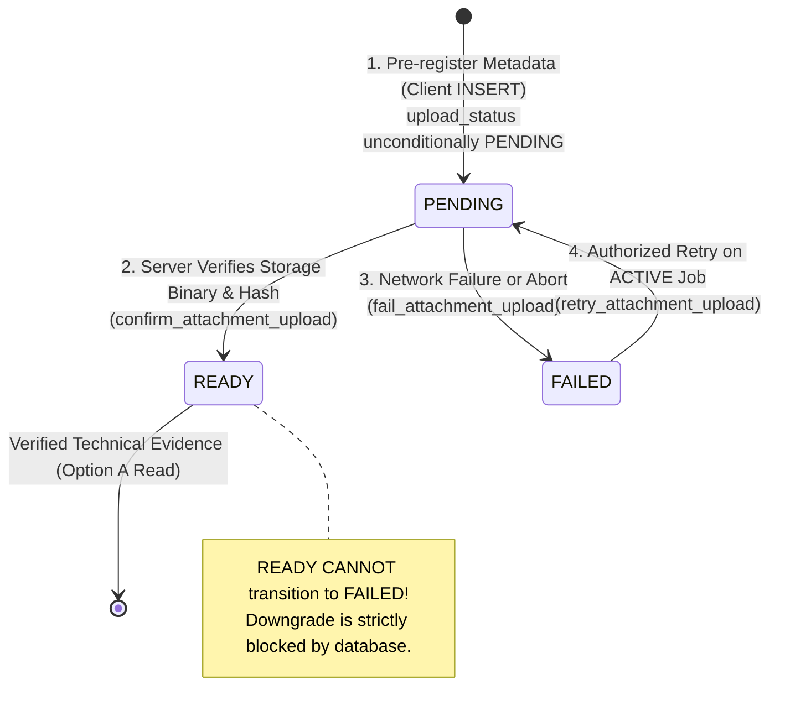
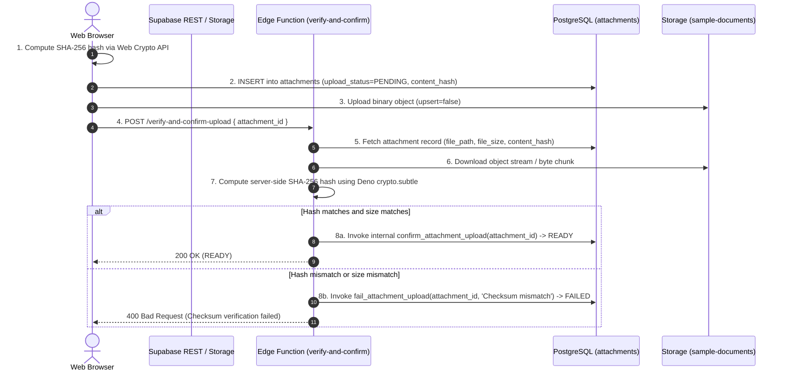

# SAMPLE TRACKING V1.0 — CLEAN BASELINE SECURITY DESIGN
**Project:** `C:\Sample report - AI`  
**Role:** Senior Supabase/PostgreSQL Architect and Security Engineer  
**Scope:** Architectural specification of security boundaries, trusted upload lifecycle, server-side hash verification, simplified privilege controls, and core business invariant preservation.  
**Date:** October 11, 2026  

---

## 1. ARCHITECTURAL EVALUATION: SIMPLIFYING SECURITY CONTROLS

### 1.1 The Root Cause of Incremental Complexity in R5–R9
During remediations R5 through R9, several complex mechanisms were introduced to patch specific audit findings:
1. **Session GUCs (`sample_tracking.*`):** Introduced in R8 (`00011`) to bypass closed job triggers during migration backfills and authorize internal counter updates. Codex correctly flagged this as a Blocker (R8-03) because any client could execute `SET sample_tracking.maintenance_mode = 'true'`.
2. **Internal Context Schema (`sample_tracking_internal.execution_context`):** Introduced in R9 (`00012`) to replace session GUCs with transaction-bound database records.
3. **Trigger Depth Checks (`pg_trigger_depth() >= 2`):** Introduced in R9 to verify that updates to `qa_event_counter` occurred from an insert trigger rather than direct SQL.

### 1.2 Why These Complexities Are Unnecessary in a Clean Baseline
In a fresh installation starting from a unified baseline:
1. **No Migration Backfill on Closed Jobs:** Historical jobs do not exist during initial migration execution. Schema definitions, defaults, and constraints are established *before* any production data is inserted. Therefore, **`maintenance_mode` is completely eliminated**. No trigger ever needs a bypass flag!
2. **PostgreSQL Grant Privileges as True Security Boundaries:**
   - Instead of allowing clients to execute `UPDATE public.attachments` and relying on trigger code to check whether a session token exists:
     ```sql
     REVOKE UPDATE, DELETE ON public.attachments FROM authenticated, anon;
     GRANT SELECT, INSERT ON public.attachments TO authenticated;
     GRANT ALL ON public.attachments TO postgres, service_role;
     ```
   - When `REVOKE UPDATE` is enforced at the database privilege level, PostgreSQL immediately rejects any direct client `UPDATE` with `permission denied for table attachments`.
   - Only `SECURITY DEFINER` functions owned by `postgres` (such as `confirm_attachment_upload`, `fail_attachment_upload`, `retry_attachment_upload`) can execute updates on `public.attachments`.
3. **Column-Level Privilege for Server-Owned Counters:**
   - On `job_operations`, clients must be able to update operational fields (like status, notes, reopened metadata), but must NEVER update `qa_event_counter`.
   - Rather than checking complex session tokens in triggers, `qa_event_counter` can be protected via:
     - Strict trigger rule: `IF NEW.qa_event_counter IS DISTINCT FROM OLD.qa_event_counter AND pg_trigger_depth() < 2 THEN RAISE EXCEPTION ...`
     - Or column-level grant: `REVOKE UPDATE (qa_event_counter) ON public.job_operations FROM authenticated, anon;`
   - This provides bulletproof defense-in-depth with zero session flags and zero transient tables.

---

## 2. TRUSTED UPLOAD LIFECYCLE & SERVER-SIDE SHA-256 VERIFICATION



### 2.1 Three-Phase State Machine Specification

#### Phase 1: Pre-Registration (`INSERT INTO attachments`)
- **Authority:** Authenticated user belonging to Planning, PE-MFG, QA, or Admin.
- **Trigger Enforcement (`enforce_attachment_integrity`):**
  1. `upload_status` is unconditionally forced to `'PENDING'`, overriding any client-provided value (`READY`, `FAILED`, `NULL`).
  2. `uploaded_by` is server-stamped to `auth.uid()`.
  3. `owning_department` is set to caller's active role. If Admin is uploading on behalf of another department, `admin_on_behalf` is set to `TRUE`.
  4. Parent Job must exist and have `status = 'ACTIVE'`.
  5. Canonical path must strictly match `<job_id>/<file_type>/<sanitized_filename>`.
  6. File size must be between 1 byte and 52,428,800 bytes (50MB).
  7. MIME type must belong to whitelist: `application/pdf`, `image/jpeg`, `image/png`.
  8. Client submits pre-computed SHA-256 hex string (`content_hash`).
  9. File type must match department whitelist:
     - **Planning:** `DRAWING`, `CHECK_SHEET`, `SETTING_SHEET`, `OTHER`
     - **PE-MFG:** `CHECK_SHEET`, `SETTING_SHEET`, `DRAWING`, `NG_PHOTO`, `OTHER`
     - **QA:** `CHECK_SHEET`, `NG_PHOTO`, `OTHER`
     - **Admin:** All categories.

#### Phase 2: Binary Object Upload to Storage
- Client uploads raw binary to bucket `sample-documents` at the exact path registered.
- Storage upload uses `upsert: false` (prevents silent overwrites).
- Storage RLS Policy (`storage_registered_upload`) verifies:
  - An attachment row exists matching `storage.objects.name = attachments.file_path`.
  - `upload_status = 'PENDING'`.
  - `uploaded_by = auth.uid()`.
  - Parent job `status = 'ACTIVE'`.

#### Phase 3: Server Confirmation & SHA-256 Verification (`confirm_attachment_upload`)
Transition to `'READY'` requires server-side proof of existence and metadata consistency:
1. Caller must be original `uploaded_by` or `Admin`.
2. Parent job must be `'ACTIVE'`.
3. Current record status must be strictly `'PENDING'`.
4. Physical object must exist in `storage.objects` (bucket `sample-documents`, name `file_path`).
5. Physical byte size in `storage.objects` must match declared `file_size`.
6. Server-side SHA-256 verification (detailed below).
7. Upon successful verification:
   - `upload_status := 'READY'`.
   - `last_error := NULL`.

#### Phase 4: Failure Handling (`fail_attachment_upload`)
- **Invariant:** Only `'PENDING'` attachments can transition to `'FAILED'`.
- **Anti-Downgrade Guard:** Any attempt to call `fail_attachment_upload` on an attachment that is already `'READY'` is **strictly rejected**. A verified technical document can never be invalidated by client failure calls.

#### Phase 5: Controlled Retry Lifecycle (`retry_attachment_upload`)
- **Preconditions:**
  - Caller must be original `uploaded_by` or `Admin`.
  - Parent job must be `'ACTIVE'`.
- **Reconciliation Logic:**
  - If object already exists in Storage and matches size/hash: Directly recovers status to `'READY'`.
  - If object is absent in Storage: Resets status to `'PENDING'`, updates `last_retry_at = now()`, and binds new size/MIME/hash if client is uploading a replacement binary.

---

### 2.2 Server-Side SHA-256 Verification Architecture

To guarantee that the physical binary in Storage matches the client-declared `content_hash`:



#### Dual Verification Options for Baseline V1:
- **Primary Server Verification Gateway:** Edge Function `verify-and-confirm-upload` acts as the trusted signing and verification authority. Running in the isolated Deno runtime with service credentials, it streams the object, computes the real SHA-256, compares it against `attachments.content_hash`, and transitions the DB state.
- **Database Fallback:** The stored procedure `confirm_attachment_upload` inspects `storage.objects` table metadata directly (matching size, path, bucket, and S3 ETag where available) to prevent client bypass.

---

## 3. CORE BUSINESS RULES & INVARIANTS PRESERVATION

### 3.1 Option A Document Access Policy
- **Universal Internal Read Access:** All active internal roles (`Planning`, `PE-MFG`, `QA`, `Admin`) have read access to all registered `'READY'` technical documents across all non-`'PURGED'` jobs.
- **Storage RLS:**
  ```sql
  CREATE POLICY "storage_registered_read_option_a" ON storage.objects
  FOR SELECT TO authenticated
  USING (
      bucket_id = 'sample-documents'
      AND public.is_user_active() = TRUE
      AND EXISTS (
          SELECT 1 FROM public.attachments a
          JOIN public.jobs j ON j.id = a.job_id
          WHERE a.file_path = storage.objects.name
            AND a.upload_status = 'READY'
            AND j.status != 'PURGED'
            AND public.get_current_user_role() IN ('Admin', 'Planning', 'PE-MFG', 'QA')
      )
  );
  ```
- **300-Second Signed URL Gateway (`create-signed-url`):** Enforces a strict server maximum of 300 seconds TTL. Direct client URL signing is blocked.

### 3.2 PE-Owned Manufacturing Workflow
- **Manufacturing Master:** PE owns routing progression (`NOT_STARTED -> IN_PROGRESS -> COMPLETED` / `HOLD`).
- **QA Independence:** QA is an independent evaluation authority. QA checks (`qa_checks`) are optional and do not block manufacturing by default.
- **Conditional Completion Rules:**
  1. Advancing to `COMPLETED` requires at least one completed `production_runs` record with `ok_qty > 0`.
  2. Advancing to `COMPLETED` or `HOLD` requires the caller to be the designated **PE Owner** or authorized **delegate** for the JOB (or Admin).
  3. If the most recent QA evaluation is `NG` or `KIV`:
     - Completion is **BLOCKED** unless an authorized PE Technical Disposition (`pe_technical_dispositions`) has been issued.
     - The disposition must resolve the *exact* latest QA event.
     - Decision type `HOLD` **never** authorizes completion. Allowed types: `CONTINUE_AS_IS`, `REWORK_NEXT`, `TECHNICAL_REVIEW`, `CUSTOMER_EVALUATION`.
     - The disposition timestamp must be >= the latest QA check timestamp.
     - If the operation was reopened, the disposition timestamp must be >= `reopened_at`.

### 3.3 Reopen Invariants
- Only designated PE Owner or delegate (or Admin) can reopen a `COMPLETED` operation (`COMPLETED -> IN_PROGRESS`).
- Mandatory `reopen_reason` (minimum 5 non-whitespace characters).
- Database triggers automatically stamp `reopened_by := auth.uid()` and `reopened_at := timezone('Asia/Ho_Chi_Minh', now())`.
- Dispositions created *prior* to `reopened_at` cannot authorize completion after reopening.

### 3.4 Monotonic QA Event Ordering & Immutability
- Every QA record inserted into `qa_checks` receives an auto-incremented `event_seq` per operation (`1, 2, 3...`).
- Synchronized with `job_operations.qa_event_counter`.
- Unique constraint `uq_qa_checks_operation_event_seq UNIQUE (operation_id, event_seq)`.
- QA records are strictly **immutable**: `REVOKE UPDATE, DELETE ON public.qa_checks FROM authenticated, anon;`.

### 3.5 Closed Job Immutability
- When a JOB transitions to `CLOSE`, `ARCHIVE`, or `PURGED`:
  - `jobs`: All columns locked against further edits.
  - `job_operations`: Cannot be inserted, updated, or deleted.
  - `production_runs`: Cannot be recorded.
  - `qa_checks`: Cannot be added or modified.
  - `attachments`: Cannot be uploaded, confirmed, or retried.
  - `pe_technical_dispositions`: Cannot be created or modified.
- Trigger `check_job_active_status()` enforces this across all 6 child tables.
